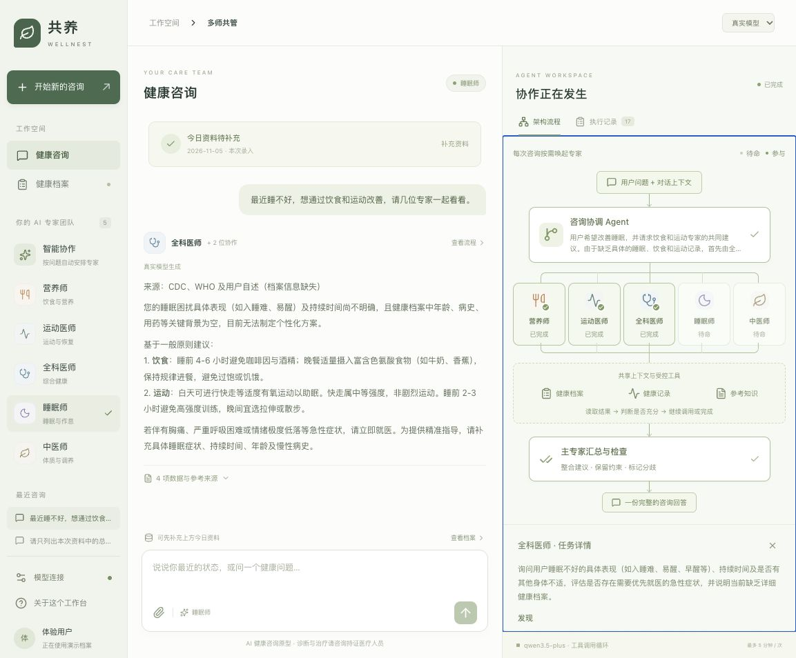
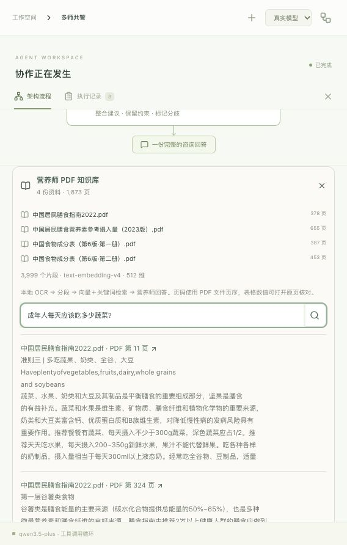
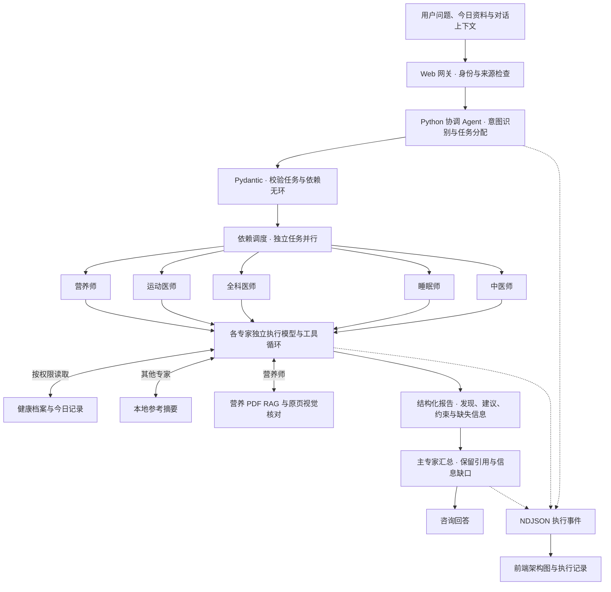
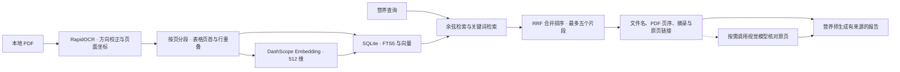

# Wellnest 共养 · 多 Agent 健康管理工作台

一个以 **Python / FastAPI** 为核心后端的多 Agent 与 RAG 开源演示项目。用户在同一对话中咨询饮食、运动、睡眠等问题，协调 Agent 按需分配营养师、运动医师、全科医师、睡眠师和中医师，专家调用工具获取资料，再由主专家汇总回答。

页面同时呈现咨询内容与实际执行流程，便于观察任务分配、工具调用、专家报告和引用来源。

[本地运行](#本地运行) · [架构流程](#架构流程) · [营养师 PDF RAG](#营养师-pdf-rag) · [MIT 许可证](LICENSE)

## 界面预览

### 咨询与 Agent 工作流

同屏查看咨询结果、参与专家、执行状态和任务详情。以下截图使用演示档案展示界面。



### 营养知识库与检索证据

知识库面板展示已导入资料、索引规模、检索片段与 PDF 页序。以下为本地知识库的运行截图。



## 项目亮点

| 能力 | 实现 |
| --- | --- |
| 多专家协作 | 协调模型生成包含主专家、子任务和依赖关系的任务图，Pydantic 与 Python 调度逻辑校验结构和依赖 |
| 按依赖调度 | 独立专家并行执行，有依赖的专家等待上游报告，上游失败时阻止依赖任务继续 |
| 专家工具循环 | 每位专家具备角色指令、可用工具、任务上下文和结构化报告，按权限读取档案、记录或知识库 |
| 可观察的执行过程 | 服务端通过 NDJSON 推送路由、工具、专家与汇总事件，前端同步更新架构节点和执行记录 |
| 营养 PDF RAG | 扫描件 OCR、表格方向校正、按页分段、向量与关键词混合检索、RRF 排序及原页引用 |
| 视觉核对 | 营养师可调用视觉模型核对食物成分表原页，图片附件也可提取可见信息供用户核对 |
| 执行边界 | 工具轮数、模型调用预算、超时、取消、格式修正与检索降级均由代码控制 |

核心后端采用 Python 3.11+、FastAPI、Pydantic、HTTPX、asyncio、SQLite FTS5 与 RapidOCR。React 19 / TypeScript 负责网页与工作流可视化，Vinext / Cloudflare Worker 作为同源 API 网关。各专家复用配置的文本模型，通过角色、任务、工具权限和执行上下文区分职责。

## 架构流程

下图展示真实模型模式的咨询执行路径。一次咨询仅唤起任务图中选定的专家，工具返回的信息进入该专家的后续模型调用。



营养知识库通过独立的 Python / FastAPI 服务访问 SQLite 索引。离线建库和在线检索按下面的流程衔接。



## 演示路径

1. 启动应用，新建咨询，填写今日睡眠、饮食和运动资料，也可一键填入虚构演示资料。
2. 在演示模式输入“最近睡不好，想通过饮食和运动改善，请几位专家一起看看”，观察规则路由与预设输出驱动的流程。
3. 配置 API Key 后切换真实模型，再提问并展开专家节点，查看模型实际分配的任务、工具结果和报告。
4. 完成 PDF 建库后，在知识库面板搜索问题，或让营养师查询饮食资料，检查返回的文件名、PDF 页序和原页。

目前提供截图与上述操作路径，演示视频待补充。项目支持本地运行，托管部署的条件见下方部署章节。

## 数据与复现范围

本地示例知识库已完成 4 份 PDF、1,873 页、3,999 个片段的索引。这些数字描述该批资料的处理规模，检索质量与回答质量仍需独立评估。

公开仓库提供应用源码、建库脚本和配置模板。运行营养 RAG 时，请自行准备有权使用的 PDF 并建立索引。原始 PDF、OCR 缓存、向量数据库、API Key 和本地服务令牌均通过 `.gitignore` 排除。

## 本地运行

需要 Python 3.11+ 与 Node.js 22.13+。先安装 Python API 依赖，再安装网页依赖。

```sh
python3 -m venv .venv
source .venv/bin/activate
python -m pip install -r backend/requirements.txt
npm install
cp .env.example .dev.vars
# 在 .dev.vars 中填写 LLM_API_KEY 和 BACKEND_SERVICE_TOKEN
npm run dev -- --host 127.0.0.1 --port 3000
```

`npm run dev` 会启动 Python 后端（默认 3012 端口）与 Web 网关（3000 端口）。未填写服务令牌时，开发启动器生成仅用于当前进程的随机令牌。已有 `RAG_SERVICE_TOKEN` 可兼容使用，旧的 `RAG_SERVICE_URL` 不再参与请求路由。

也可通过 `npm run backend:serve` 单独启动后端，此时需在 `.dev.vars` 配置服务令牌。后端 HTTP 接口均要求 Bearer 令牌，前端通过同源网关访问。

打开终端输出的本地地址。已有 `.dev.vars` 时请直接编辑，复制模板会覆盖原有配置。修改配置后重启服务。

默认先进入演示模式。右上角可切换到真实模型，模型连接窗口显示服务端密钥是否已配置。密钥仅由服务端读取，配置文件已被 Git 忽略。

配置默认使用 DashScope 的 OpenAI 兼容接口，文本模型 `qwen3.5-plus`，视觉模型 `qwen3-vl-plus`，温度 0.2，单次文本请求超时 60 秒，视觉请求超时 120 秒。非流式模型调用显式设置 `enable_thinking: false`。前端执行事件通过 NDJSON 实时传输。

## 每次对话的今日资料

新建对话会显示独立的资料收集卡，包含记录日期、睡眠总时长、深睡时长、浅睡时长、饮食和运动。时长按小时和分钟填写，未知项可以留空。深睡与浅睡总和超过总时长时会提示修正。

可以一键填写虚构演示资料，也可以跳过或稍后补充。今日资料绑定到当前会话，专家通过健康记录工具读取。新对话重新开始收集。历史旧对话继续使用原有档案读取方式。手动录入今日资料时使用用户基础档案，基础档案仍为演示状态时采用空白基础档案，避免混用虚构个人信息。

## 咨询与可视化

- 左侧选择智能协作或指定专家偏好，支持连续对话和图片附件。
- 右侧架构图展示协调 Agent、五位专家、共享数据工具和主专家汇总。
- 节点随实际事件切换待命、处理中、已完成或失败状态。
- 点击专家节点查看分配的任务、工具结果与结构化报告。
- 执行记录保留事件时间、工具结果、失败原因。展示任务与行动摘要。
- 桌面展示双栏，窄屏通过右上角流程按钮切换咨询与架构视图。

## 两种运行方式

### 演示模式

使用关键词路由和预设输出，实际读取当前填写的档案。页面明确标注演示模式和虚构档案，适合演示专家选择、并行任务、工具查询和汇总流程。

### 真实模型模式

1. 协调模型读取当前问题、最近八轮成功对话、专家偏好和基础档案摘要。
2. 返回经 Pydantic 校验的任务图，包含主专家、子任务及依赖。代码拒绝重复专家、缺少主专家、循环或不存在的依赖。
3. 独立任务并行执行，有依赖的任务等待上游完成。上游失败时暂停依赖它的任务。
4. 每位专家自主选择工具，工具结果返回模型。最多四轮工具选择、八次工具执行，随后强制形成报告。报告格式校验失败时最多修正一次，所有模型调用仍受总预算约束。
5. 主专家整合已完成报告，检查建议和适用条件，保留冲突、失败及信息缺口。
6. 每次咨询最多 28 次模型调用，整体最长五分钟。用户可中止并重新执行。

图片附件通过视觉模型提取可见文字与信息，作为待用户核对的资料加入当前任务。支持 PNG、JPEG、WebP，最大 4 MB。图片只随当前请求传输，历史不保存原图，重试图片问题需要重新上传。

## 多师中的拍照记餐

聊天输入框的「拍食物」入口支持拍照/相册，真实模型下也可输入食物描述。普通图片附件可点「转为拍照记餐」。营养师生成餐食草稿，可修改日期、餐次、实际食用克数、减半分量或移除未食用项目；食物识别有误时重新描述识别。没有识别到食物或分量未知时不能确认。

确认后才进入当前咨询的共享饮食记录和今天汇总，可点击「请营养师解读」继续咨询。修改已确认记录时暂时退出汇总，重新确认后覆盖同一条记录。演示模式提供固定示例，和真实记录隔离。草稿不进入咨询历史上下文或记录工具，原图不保存；记录与会话一起保存在当前浏览器，遵循原有最多十二个会话的保留范围。当天汇总仅覆盖当前咨询，不是跨会话长期饮食账本。

识别使用现有视觉/文本模型配置，不依赖独立 NutriAgent 服务。每100克营养值仍为 AI 参考估算；Python 按用户确认的克数计算，当前未将照片中的每种食物自动匹配到权威数据库，现有 PDF RAG 保留用于营养建议核验。`/api/meals/analyze` 返回草稿，`/api/meals/calculate` 校验确认记录，`/api/chat` 接收已确认记录并重新计算后交给健康记录工具。

## 回答速度与流式输出

真实模式为明确的日常餐食解读、饮食搭配、睡眠/运动记录整理提供保守的快速路径：没有已知疾病、用药或过敏约束，且问题和历史没有复杂诉求时，直接分配对应专家，按权限预读本地记录，再用一次模型调用流式回答。模糊问题、话题跨域、症状、文献推荐量和专业约束仍由协调模型分配。普通追问仅在可确认前一条为日常意图时延续专家。

单专家不再生成内部结构化报告后重复汇总：非快速问题保留有界工具准备阶段，营养师仍检索知识库并可核对原页，证据准备完成后直接生成正文。多专家保留依赖调度、结构化报告及一致性汇总，最后的汇总正文改为流式返回。日常快速路径不新报文献推荐量或医学目标。

`/api/chat` 的 NDJSON 增加 `answer_delta` 事件，最终 `result` 是完整结果；中断、超时、截断或错误流不能被标记为完成，也不会进入成功对话上下文。取消会关闭上游模型连接。执行详情及“耗时统计”显示服务端首段正文时间、总耗时、模型调用次数和路由/工具/专家/汇总阶段耗时；并行阶段的耗时不可直接相加作为总耗时。

## 数据与工具

- `read_health_profile` 读取用户基本档案、目标、健康约束、用药和过敏信息。
- `read_health_records` 读取当前档案中的睡眠、饮食、运动或体征文本，权限由服务端按专家限制。
- `search_knowledge` 对小型本地参考库进行主题匹配，当前收录 CDC 睡眠与 WHO 饮食摘要，返回原始链接。营养师使用下方独立的 PDF RAG。

工具将未知数据保留为缺失。虚构档案与用户录入分别标记来源。会话和档案保存在当前浏览器的 localStorage，最多保留十二个会话，单次请求携带最近八轮成功对话。

设备数据 API、医院数据接口、临床审核、多用户云端档案和长期后台任务服务需另行接入。当前全科、运动、中医等未覆盖主题的知识检索可能返回空结果。

## 文件结构

| 文件 | 职责 |
| --- | --- |
| `app/page.tsx` | 咨询界面、动态图、会话、档案、模型状态 |
| `app/api/chat/route.ts`、`lib/backend.ts` | 同源网关、身份与来源检查、请求体上限、转发实时事件流 |
| `app/api/config/route.ts` | 返回模型参数与密钥配置状态 |
| `backend/wellnest/orchestrator.py` | 路由、asyncio 依赖调度、专家循环、主专家汇总 |
| `backend/wellnest/provider.py` | HTTPX 异步千问请求、超时、调用预算、错误脱敏 |
| `backend/wellnest/tools.py` | 工具权限、记录读取、本地知识检索、原页视觉核对 |
| `backend/wellnest/models.py`、`api.py` | Pydantic 数据契约、FastAPI 接口与 NDJSON 事件流 |
| `backend/wellnest/rag.py`、`indexer.py` | 混合检索、PDF 原页访问、断点建库与原子替换 |
| `scripts/rag/extract.py` | 扫描件 OCR 与页面方向校正 |
| `app/components/daily-intake.tsx` | 每次对话的资料收集与摘要 |
| `lib/intake.ts` | 今日资料校验、时间格式化与会话档案合并 |
| `lib/domain.ts` | 领域类型、数据校验、五位专家定义、演示档案 |
| `backend/tests/` | 编排、工具权限、失败依赖、取消、接口、旧索引与重建回归检查 |
| `tests/intake.test.ts` | 今日资料与历史会话兼容性检查 |

## 验证

```sh
npm run typecheck
npm test
npm run build
```

`npm test` 执行 24 项 Python 后端回归测试与 3 项前端资料测试，覆盖并行调度、断开连接取消、工具预算、引用核验、旧索引读取及失败重建保护。

真实调用需要用户自行配置的 API Key 与对应模型区域权限。自动化测试使用模拟模型响应，不产生模型调用费用。

## 部署

部署包含 Web 网关和 Python 后端两个进程。Python 服务配置 `LLM_API_KEY`、模型参数与 `BACKEND_SERVICE_TOKEN`，并挂载 PDF 和 SQLite 索引。Web 网关配置受保护的 `BACKEND_SERVICE_URL` 与相同服务令牌。网关在非本机地址要求平台身份，后端接口要求 Bearer 令牌。当前保留 Sites 构建集成，本地代码未包含有效的 Sites 项目注册 ID，托管发布需另行完成平台注册与部署。

咨询内容用于功能演示和一般健康管理信息。需要专业判断的诊断、处方、治疗调整应由持证医疗人员处理，临床内容与规则上线前应经过专业审核。

## 营养师 PDF RAG

营养师真实模式会先检索用户提供的四份 PDF，然后按需补充查询。检索返回的文件名、PDF 页序、OCR 摘录和原页链接进入专家上下文，右侧执行记录可以查看每次工具输入与返回结果。架构图下方的“营养师 PDF 知识库”可查看资料、索引进度并独立搜索。

### 数据流程

1. 本地 RapidOCR 逐页识别扫描件，保存文字、置信度和页面坐标。原始 PDF 的 SHA-256 确定文档身份，OCR 页面可断点续跑。
2. 校正横向表格方向，跳过无文字与仅有少量标题的页面。按页与文字行分段，目标约 900 字，保留两行重叠。食物成分表重复页首文字，保留可识别的行内顺序。
3. 使用 DashScope `text-embedding-v4` 建立 512 维向量，和中文分词后的 SQLite FTS5 全文索引一起存储在本机。
4. 查询同时执行余弦向量检索和关键词检索，以 Reciprocal Rank Fusion 合并排序，最多返回五个片段。向量请求失败时明确标注关键词降级。
5. 营养师使用 `search_nutrition_knowledge` 获取证据。食物成分表的精确数值需要通过 `verify_nutrition_page` 调用已有视觉模型核对原页，再保留单位、计量基准和适用条件。视觉识别仍需人工核验。
6. 主专家汇总时保留文献引用，来源展开后显示原文片段，点击文件名可以打开对应扫描页。

扫描件可能有错字、数字误识别和表格错列。PDF 页序与书中印刷页码可能不同。检索结果需要结合问题判断相关性，未找到依据时保留信息缺口。

### 本机运行与重建

Python 启动器按 `PYTHON` 环境变量、项目 `.venv`、旧 `.rag/runtime.json` 的顺序查找解释器，兼容迁移前的 OCR 环境。`npm run dev -- --host 127.0.0.1 --port 3000` 会同时启动 Web 应用与 Python 后端。原始书籍放在 `RAG/`，OCR、向量数据库和原页缓存放在 `.rag/`，两个目录均已加入 `.gitignore`。

首次在另一台机器建立知识库需要 Node.js 22.13+、Python 3.11+，以及 `.dev.vars` 中的模型配置和 `BACKEND_SERVICE_TOKEN`。可按 `.env.example` 生成随机本地服务令牌。默认 Python 后端监听 `127.0.0.1:3012`。已有 SQLite 索引与页面缓存可直接复用。

```sh
python -m pip install -r scripts/rag/requirements.txt
npm run rag:extract
npm run rag:index
npm run dev -- --host 127.0.0.1 --port 3000
```

新增或替换 PDF 后依次执行 `rag:extract` 和 `rag:index`。相同文件的 OCR 页面会复用，索引构建失败可重新执行继续向量化。完整的新索引构建成功后才替换旧索引，服务自动加载更新。如果进程异常退出留下 `.rag/index.lock`，确认旧索引进程已停止后再移除此锁文件。

OCR 在本机完成。建立向量时文档片段会发送到已配置的 DashScope 接口，咨询时检索片段和按需核对的原页会发送到对应千问模型。密钥与本地服务令牌均仅在服务端读取。

这一版 RAG 使用独立的 Python / FastAPI 服务与 SQLite 文件。部署到云端时需要单独部署可访问 PDF 和索引的服务，并配置受保护的 `BACKEND_SERVICE_URL`，Cloudflare Worker 本身无法读取本机目录。

## 许可证

本项目原创代码与文档采用 MIT 许可证，版权署名为 HE JIE。完整条款见 [LICENSE](LICENSE)。

第三方依赖与随仓库保留的第三方代码遵循各自许可证，相关声明保留在 `vendor/` 与 `scripts/vite/` 中。外部 PDF 资料及截图中的书籍摘录，其权利归原权利人所有，使用时应遵守相应授权条件。

### 后端实现参考

流式接口使用 FastAPI `StreamingResponse`，模型调用使用 HTTPX 异步客户端。实现方式参考官方文档。[FastAPI 响应文档](https://fastapi.tiangolo.com/advanced/custom-response/)、[HTTPX 异步客户端](https://www.python-httpx.org/async/)
